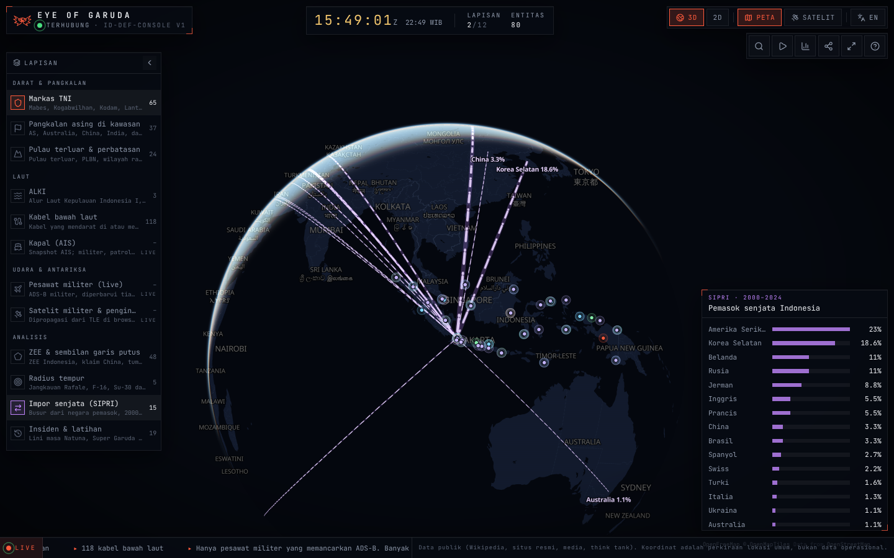

# Eye of Garuda

[](https://github.com/Avalon2222/eye-of-garuda/actions/workflows/ci.yml)
[](https://nextjs.org)
[](https://maplibre.org)
[](LICENSE)

> **The archipelago never sleeps. Neither does the eye.**
> Konsol globe interaktif untuk melihat postur pertahanan Indonesia dari orbit: markas TNI, pangkalan asing di kawasan,
> pulau terluar, ALKI, kabel bawah laut, pesawat militer yang terbang sekarang, satelit di atas kepala, kapal dari AIS,
> dan analisis ZEE, radius tempur, impor senjata, serta lini masa insiden. Semuanya dari data publik.

**Live:** https://eye-of-garuda.vercel.app


<p align="center">
  
  
</p>

## 🇬🇧 In English

**A dark, smooth, Osiris-style defense console for Indonesia, rendered on a WebGL globe.** Every entity is a
MapLibre layer (not a DOM marker), so thousands of points, lines and moving objects stay buttery at 60 fps. Aircraft,
ships and satellites move without a page refresh: positions are extrapolated from speed and heading between updates,
and satellites are propagated from TLE in the browser.

- **Explore** 65 TNI bases, 37 foreign bases in the region, outer islands and border posts, the three archipelagic
  sea lanes and 118 undersea cables, each with its public source.
- **Watch** military aircraft broadcasting ADS-B, military and reconnaissance satellites overhead, and an AIS snapshot
  of ships colour-coded by type, with sanctioned vessels flagged.
- **Analyse** Indonesia's EEZ against the nine-dash line, combat-radius rings from each air base, SIPRI arms-import arcs
  and a curated timeline of Natuna incidents and joint exercises.
- **Share** any view: camera, active layers, language and selection live in the URL. Press `T` for a cinematic briefing.

Built with Next.js 16, TypeScript, Tailwind 4, MapLibre GL (globe projection), satellite.js. Data prepared with Python.
Deployed on Vercel. Bilingual (ID/EN), keyboard-driven, works on phones.
*The rest of this README is in Indonesian.*

## Mengapa

Proyek [indonesia-defense-gis](https://github.com/Avalon2222/indonesia-defense-gis) memetakan hal yang sama dengan
Streamlit dan Folium. Peta itu informatif, tetapi terasa seperti laporan. Eye of Garuda adalah versi "ruang komando":
globe yang berputar, panel kaca, jam ZULU, dan objek yang benar-benar bergerak. Tujuannya sederhana: membuat data
publik tentang pertahanan Indonesia terasa hidup dan mudah dijelajahi.

## Lapisan

| # | Lapisan | Jenis | Sumber singkat |
|---|---|---|---|
| 1 | Markas TNI (Mabes, Kogabwilhan, Kodam, Lantamal, Koarmada, Lanud) | statis | Wikipedia |
| 2 | Pangkalan asing di kawasan (AS, Australia, China, India, tetangga) | statis | Wikipedia, CSIS AMTI |
| 3 | Pulau terluar, PLBN, wilayah rawan | statis | Keppres 6/2017, Wikipedia |
| 4 | ALKI I/II/III | statis | PP 37/2002 (ilustratif) |
| 5 | Kabel bawah laut + landing station | statis | TeleGeography |
| 6 | Kapal (snapshot AIS, posisi diekstrapolasi) | live | aisstream.io, OpenSanctions |
| 7 | Pesawat militer (ADS-B, diperbarui tiap 10 detik) | live | adsb.lol, airplanes.live |
| 8 | Satelit militer & pengintai (SGP4 di browser) | live | CelesTrak, GCAT |
| 9 | ZEE Indonesia & sembilan garis putus | analisis | Marine Regions |
| 0 | Radius tempur dari tiap Lanud | analisis | angka publik |
| - | Impor senjata (busur SIPRI) | analisis | SIPRI |
| = | Insiden & latihan bersama | analisis | media, Wikipedia |

Rincian sumber, lisensi, dan batasan tiap lapisan ada di [`data/SUMBER_DATA.md`](data/SUMBER_DATA.md).

## Cara pakai

| Tombol | Fungsi |
|---|---|
| `Ctrl` `K` atau `/` | Cari entitas (markas, pulau, pangkalan, kabel, kapal, satelit) |
| `T` | Mulai / hentikan briefing sinematik (Natuna → Selat Malaka → Darwin → Guam) |
| `1`–`9`, `0`, `-`, `=` | Nyalakan / matikan lapisan |
| `S` | Peta gelap ↔ citra satelit |
| `G` | Globe 3D ↔ datar 2D |
| `L` | Bahasa Indonesia ↔ English |
| `D` | Panel anggaran & alutsista |
| `F` | Layar penuh |
| `R` | Kembali ke Indonesia |
| `?` | Bantuan |

Tombol bagikan menyalin tautan yang menyimpan posisi kamera, lapisan aktif, bahasa, dan entitas terpilih,
misalnya `#v=3.9/108.9/6/-25/50&l=tni,asing,zee&sel=tni-64`.

## Cara kerja

```
data/*.csv  ──scripts/bangun_data.py──▶  public/data/*.geojson   (statis, dibangun saat data berubah)
TLE + GCAT  ──scripts/bangun_satelit.py─▶ cabang `data`/satelit.json  (harian, GitHub Actions)
aisstream   ──scripts/ambil_ais.py──────▶ cabang `data`/kapal.json    (tiap 30 menit, GitHub Actions)
adsb.lol    ──app/api/pesawat───────────▶ browser, tiap 10 detik
```

- **Globe & lapisan.** MapLibre GL dengan proyeksi globe. Basemap vektor gelap dari OpenFreeMap (tanpa kunci API),
  citra satelit dari Esri untuk mode SAT. Tiap lapisan adalah satu source GeoJSON + beberapa layer WebGL;
  menambah lapisan baru cukup satu entri di `src/lib/layers.ts` dan satu fungsi pemasang di `src/lib/mapLayers.ts`.
- **Gerak mulus.** Pesawat: posisi diprediksi tiap frame dari kecepatan + haluan sejak fix terakhir; saat fix baru
  datang, selisihnya dihaluskan selama 1,5 detik agar ikon tidak melompat. Kapal: ekstrapolasi dari COG/SOG sejak waktu
  laporan (maksimal 90 menit). Satelit: SGP4 (satellite.js) dihitung ulang tiap 250 ms.
- **Data live tanpa redeploy.** Snapshot AIS dan katalog satelit ditulis GitHub Actions ke cabang `data`, dibaca
  browser lewat raw.githubusercontent.com. Cabang `main` tetap bersih dan Vercel tidak perlu build ulang.
- **URL sebagai state.** Kamera, lapisan, bahasa, mode, dan pilihan disimpan di hash URL, jadi setiap tampilan bisa
  dibagikan.

## Menjalankan sendiri

```bash
npm install
python scripts/bangun_data.py      # CSV -> GeoJSON (opsional, hasilnya sudah ada di public/data)
npm run dev                        # http://localhost:3000
```

Untuk snapshot AIS, tambahkan secret `AISSTREAM_API_KEY` di repositori (Settings → Secrets and variables → Actions),
lalu jalankan workflow "Snapshot AIS" secara manual sekali.

## Kejujuran data

- Hanya data publik. Koordinat adalah perkiraan lokasi umum, bukan data operasional.
- Hanya pesawat militer yang memancarkan ADS-B yang terlihat; banyak jet tempur terbang gelap.
- Cakupan AIS tipis di luar Singapura/Batam; kapal perang sering mematikan AIS.
- Sembilan garis putus digambar ilustratif; radius tempur hanya jarak geometris dari angka publik.
- Label "pangkalan asing di kawasan" netral; sebagian besar milik negara mitra.

## Rencana berikutnya

- Relay AIS yang selalu menyala agar kapal benar-benar real-time.
- Jejak satelit penuh dan prediksi lintasan berikutnya di atas Indonesia.
- Histori snapshot (siapa yang lewat Selat Malaka minggu ini).
- Mode "perang" dengan skenario pemutusan kabel dari proyek cut-the-cable.

## Lisensi

MIT. Data pihak ketiga mengikuti lisensi masing-masing (lihat `data/SUMBER_DATA.md`).
