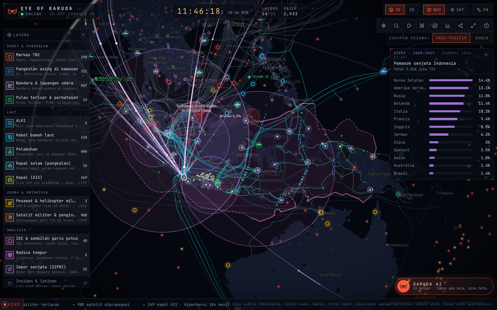
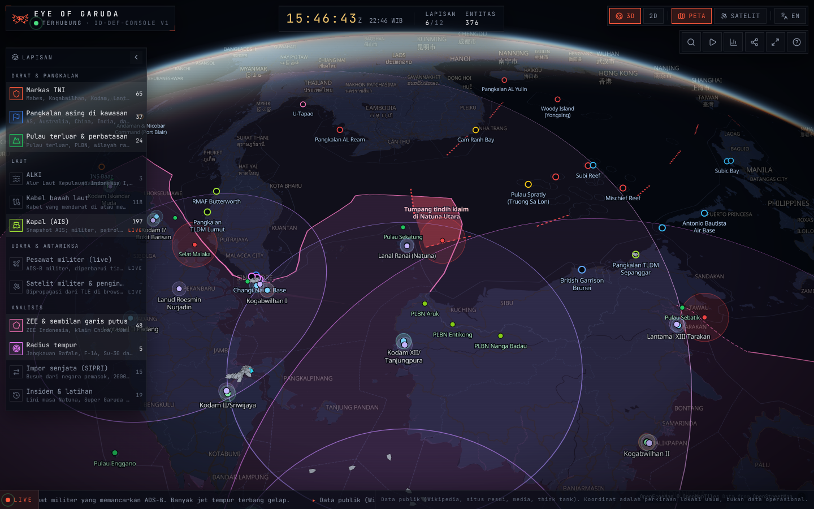
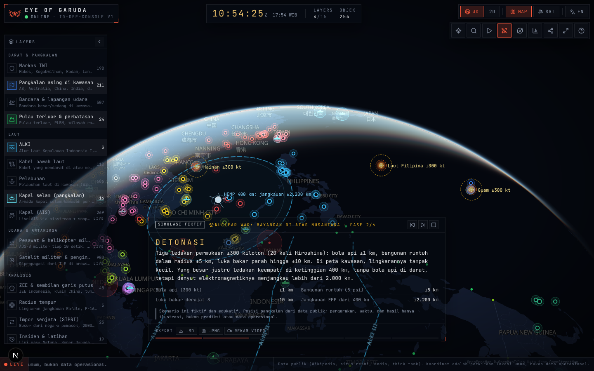

# Eye of Garuda

[](https://github.com/Avalon2222/eye-of-garuda/actions/workflows/ci.yml)
[](https://nextjs.org)
[](https://maplibre.org)
[](LICENSE)

> **The archipelago never sleeps. Neither does the eye.**
> Konsol globe interaktif untuk melihat postur pertahanan Indonesia dari orbit: markas TNI, pangkalan asing di kawasan,
> pulau terluar, ALKI, kabel bawah laut, bandara, pelabuhan, pangkalan kapal selam, pesawat dan helikopter militer yang
> terbang sekarang, satelit di atas kepala (plus jadwal lintasannya), kapal dari AIS live, analisis ZEE, radius tempur,
> impor senjata SIPRI, lini masa insiden, tiga simulasi War Room, dan asisten yang bisa ditanya. Semuanya dari data publik.

**Live:** https://eye-of-garuda.vercel.app



<p align="center">
  
  
</p>

## 🇬🇧 In English

**A dark, smooth, Osiris-style defense console for Indonesia, rendered on a WebGL globe.** Static entities are
MapLibre layers (not DOM markers), so thousands of points and lines stay buttery at 60 fps. Moving objects (aircraft,
satellites, scenario actors) are drawn on a separate canvas every frame: aircraft positions are extrapolated from speed
and heading between updates, satellites are propagated from TLE with SGP4 in the browser and drawn at a height that
scales with their orbit, so LEO, MEO and GEO look different.

- **Explore** ~200 TNI bases (geocoded against OpenStreetMap), ~210 foreign bases in the region, 16 submarine home
  ports, 500+ airports and 600+ ports, outer islands and border posts, the three archipelagic sea lanes and 118 undersea
  cables, each with its public source. Level of detail follows the zoom: major HQs from orbit, Korem and Lanal up close.
- **Watch** military aircraft and helicopters broadcasting ADS-B (labelled by country, e.g. `RCH123 (USA)`), ~900
  military and reconnaissance satellites overhead with a pass schedule for Indonesia (`O`), and AIS ships merged from a
  live stream and a 30-minute snapshot.
- **Analyse** Indonesia's EEZ against the nine-dash line, combat-radius rings from each air base, SIPRI arms-import arcs
  pulled monthly from the SIPRI database (2000–2025), and a draggable timeline of Natuna incidents and joint exercises.
- **Play** three fictional, educational War Room scenarios (`W`): a North Natuna Sea crisis, a cable cut in the
  Singapore Strait, and a nuclear exchange seen from Indonesia, with animated ships, aircraft, missiles, detonations,
  EMP and fallout. Export any run as Markdown, PNG or a screen recording.
- **Ask** Garuda AI (`C`, bottom right) about layers, sources or how to use the console; it can fly the globe to the
  answer. Runs on a free Groq key, falls back to an offline FAQ mode.
- **Share** any view: camera, active layers, language and selection live in the URL. Press `T` for a cinematic briefing.
  A short onboarding guide runs on the first visit.

Built with Next.js 16, TypeScript, Tailwind 4, MapLibre GL (globe projection), satellite.js. Data prepared with Python.
Deployed on Vercel. Bilingual (ID/EN), keyboard-driven, works on phones.
*The rest of this README is in Indonesian.*

## Mengapa

Proyek [indonesia-defense-gis](https://github.com/Avalon2222/indonesia-defense-gis) memetakan hal yang sama dengan
Streamlit dan Folium. Peta itu informatif, tetapi terasa seperti laporan. Eye of Garuda adalah versi "ruang komando":
globe yang berputar, panel kaca, jam ZULU, dan objek yang benar-benar bergerak. Tujuannya sederhana: membuat data
publik tentang pertahanan Indonesia terasa hidup dan mudah dijelajahi.

## Lapisan

| # | Lapisan | Jenis | Sumber singkat |
|---|---|---|---|
| 1 | Markas TNI: Mabes, Kogabwilhan, semua Kodam & Korem, Lantamal & Lanal, Koarmada, Lanud, Kopassus, Kostrad, Marinir (~200) | statis | Wikipedia, Wikidata, OurAirports |
| 2 | Pangkalan asing di kawasan: AS, Australia, China, India, tetangga (~210) | statis | Wikidata, Wikipedia, CSIS AMTI |
| `[` | Bandara besar/sedang di kawasan + lapangan udara militer (507) | statis | OurAirports |
| 3 | Pulau terluar, PLBN, wilayah rawan | statis | Keppres 6/2017, Wikipedia |
| 4 | ALKI I/II/III | statis | PP 37/2002 (ilustratif) |
| 5 | Kabel bawah laut + landing station | statis | TeleGeography |
| `]` | Pelabuhan laut di kawasan (606) | statis | Wikidata |
| `;` | Pangkalan kapal selam di kawasan + jumlah & kelas armada (16) | statis | halaman armada publik, Wikipedia |
| 6 | Kapal (stream AIS live + snapshot 30 menit, posisi diekstrapolasi) | live | aisstream.io, OpenSanctions |
| 7 | Pesawat & helikopter militer (ADS-B tiap 10 detik, kategori + negara) | live | adsb.lol, airplanes.live |
| 8 | Satelit militer & pengintai (SGP4 di browser, kelas orbit LEO/MEO/GEO/HEO, jadwal lintasan) | live | CelesTrak, GCAT |
| 9 | ZEE Indonesia & sembilan garis putus | analisis | Marine Regions |
| 0 | Radius tempur dari tiap Lanud | analisis | angka publik |
| - | Impor senjata 2000–2025 (busur SIPRI, diperbarui bulanan) | analisis | SIPRI Arms Transfers Database |
| = | Insiden & latihan bersama | analisis | media, Wikipedia |

Rincian sumber, lisensi, dan batasan tiap lapisan ada di [`data/SUMBER_DATA.md`](data/SUMBER_DATA.md).

## Cara pakai

| Tombol | Fungsi |
|---|---|
| `Ctrl` `K` atau `/` | Cari entitas (markas, pulau, pangkalan, kabel, kapal, satelit) |
| `T` | Mulai / hentikan briefing sinematik (Natuna → Selat Malaka → Darwin → Guam) |
| `W` | War Room: pilih simulasi Natuna, Cable Cut, atau Nuclear (fiktif, edukatif) |
| `O` | Jadwal lintasan satelit di atas Indonesia 12 jam ke depan |
| `C` | Buka / tutup Garuda AI (pojok kanan bawah) |
| `1`–`9`, `0`, `-`, `=`, `[`, `]`, `;` | Nyalakan / matikan lapisan |
| `S` | Peta gelap ↔ citra satelit |
| `G` | Globe 3D ↔ datar 2D |
| `L` | Bahasa Indonesia ↔ English |
| `D` | Panel anggaran & alutsista |
| `F` | Layar penuh |
| `R` | Kembali ke Indonesia |
| `?` | Bantuan |

Tombol bagikan menyalin tautan yang menyimpan posisi kamera, lapisan aktif, bahasa, dan entitas terpilih,
misalnya `#v=3.9/108.9/6/-25/50&l=tni,asing,zee&sel=tni-64`.

## Cara kerja

```
data/*.csv  ──scripts/bangun_data.py──▶  public/data/*.geojson   (statis, dibangun saat data berubah)
OSM/OurAirports ─scripts/koreksi_lokasi.py▶ data/markas_tni.csv   (geocoding markas, sekali jalan)
data/*.csv  ──scripts/cek_tautan.py─────▶ laporan tautan mati         (bulanan, GitHub Actions)
TLE + GCAT  ──scripts/bangun_satelit.py─▶ cabang `data`/satelit.json  (harian, GitHub Actions)
aisstream   ──scripts/ambil_ais.py──────▶ cabang `data`/kapal.json    (tiap 30 menit, GitHub Actions jalan terus)
aisstream   ──app/api/kapal─────────────▶ browser, tiap 60 detik (live, kalau AISSTREAM_API_KEY ada di Vercel)
SIPRI API   ──scripts/ambil_sipri.py────▶ cabang `data`/sipri.json    (bulanan, GitHub Actions)
adsb.lol    ──app/api/pesawat───────────▶ browser, tiap 10 detik
```

- **Globe & lapisan.** MapLibre GL dengan proyeksi globe. Basemap vektor gelap dari OpenFreeMap (tanpa kunci API),
  citra satelit dari Esri untuk mode SAT. Tiap lapisan adalah satu source GeoJSON + beberapa layer WebGL;
  menambah lapisan baru cukup satu entri di `src/lib/layers.ts` dan satu fungsi pemasang di `src/lib/mapLayers.ts`.
- **Gerak mulus.** Pesawat dan satelit tidak lagi menjadi source GeoJSON yang di-`setData` tiap frame (itu membuat
  worker MapLibre sibuk dan toggle lapisan jadi lambat), melainkan digambar di satu kanvas 2D di atas peta
  (`src/lib/kanvasLive.ts`) memakai matriks proyeksi globe MapLibre, lengkap dengan uji oklusi di balik bumi.
  Pesawat: posisi diprediksi tiap frame dari kecepatan + haluan sejak fix terakhir. Kapal: ekstrapolasi dari COG/SOG
  sejak waktu laporan (maksimal 90 menit). Satelit: SGP4 (satellite.js) bergiliran ~16 satelit per frame, di antaranya
  diekstrapolasi linier; garis orbit penuh satu periode digambar untuk satelit yang dipilih. Ketinggian visual
  dipadatkan (LEO rendah, GEO jauh) supaya tetap terlihat pada zoom berapa pun.
- **Level of detail.** Tiap titik punya `peringkat`: markas besar, Kodam, Koarmada, dan Lanud utama tampil dari zoom
  jauh, Korem/Lanal/pelabuhan kecil memudar masuk saat zoom mendekat. Satelit memudar saat zoom kota, busur SIPRI
  memudar saat zoom dekat, jadi tampilan jauh tetap ramai tapi tidak berantakan.
- **Skenario.** `src/lib/skenario/*.ts` mendefinisikan fase, kamera, aktor (kapal, pesawat, kapal selam, rudal, ICBM,
  ledakan, EMP, awan fallout, kabel putus), garis reroute, lingkaran jangkauan, dan angka jarak/waktu yang dihitung dari
  koordinat. Selama simulasi hanya lapisan yang dibutuhkan yang tampil; lapisan pengguna disimpan lalu dipulihkan saat
  selesai, dihentikan, atau diinterupsi (geser peta, klik objek). Ekspor: Markdown (`skenarioKeMarkdown`), PNG (peta +
  kanvas), rekaman WebM lewat MediaRecorder. Menambah skenario = satu berkas baru dan satu entri di `SKENARIO`.
- **Jadwal lintasan.** Web Worker (`lintasan.worker.ts`) mempropagasi semua satelit LEO 12 jam ke depan dengan langkah
  60 detik dan mencatat kapan masuk/keluar kotak Indonesia, tanpa membebani thread utama.
- **Asisten.** `app/api/chat` meneruskan pertanyaan ke API chat kompatibel OpenAI (Groq, tier gratis) dengan ringkasan
  aplikasi sebagai system prompt (`src/lib/pengetahuan.ts`), dibatasi 30 permintaan per IP per 10 menit. Jawaban boleh
  menyertakan baris `@terbang: <nama>` dan `@lapisan: <id>` yang diubah menjadi tombol untuk menerbangkan globe dan
  menyalakan lapisan. Tanpa kunci, atau saat kuota habis, widget otomatis beralih ke mode FAQ tanpa AI.
- **Data live tanpa redeploy.** Snapshot AIS dan katalog satelit ditulis GitHub Actions ke cabang `data`, dibaca
  browser lewat raw.githubusercontent.com. Cabang `main` tetap bersih dan Vercel tidak perlu build ulang.
- **URL sebagai state.** Kamera, lapisan, bahasa, mode, dan pilihan disimpan di hash URL, jadi setiap tampilan bisa
  dibagikan.

## Menjalankan sendiri

```bash
npm install
python scripts/bangun_data.py      # CSV -> GeoJSON (opsional, hasilnya sudah ada di public/data)
npm run dev                        # http://localhost:3000
```

Untuk snapshot AIS, tambahkan secret `AISSTREAM_API_KEY` di repositori (Settings → Secrets and variables → Actions),
lalu jalankan workflow "Snapshot AIS" secara manual sekali. Untuk kapal **live** di browser, set variabel lingkungan
yang sama (`AISSTREAM_API_KEY`) di Vercel → Settings → Environment Variables, lalu redeploy; tanpa itu aplikasi
memakai snapshot saja.

Untuk memperbarui angka SIPRI secara manual: `python scripts/ambil_sipri.py` (workflow "SIPRI bulanan" melakukannya
tiap bulan ke cabang `data`). Untuk mencocokkan ulang koordinat markas ke OpenStreetMap: `python scripts/koreksi_lokasi.py`.

Untuk asisten mode AI, set environment variable `GROQ_API_KEY` (kunci gratis dari https://console.groq.com/keys) di
`.env.local` atau di Vercel → Settings → Environment Variables. Tanpa kunci, asisten tetap jalan dalam mode FAQ.
Opsional: `CHAT_API_URL` dan `CHAT_MODEL` untuk memakai penyedia lain yang kompatibel OpenAI.

## Kejujuran data

- Hanya data publik. Koordinat adalah perkiraan lokasi umum, bukan data operasional. Sebagian besar markas TNI sudah
  dicocokkan ke titik OpenStreetMap (kolom `presisi=osm`); sisanya masih pusat kota (`presisi=kota`). Pangkalan asing
  dari Wikidata belum diverifikasi satu per satu (kolom `kurasi` membedakannya).
- Kapal selam tidak bisa dilacak live oleh siapa pun dengan data publik. Lapisannya hanya pangkalan induk, jumlah, dan
  kelas armada dari halaman publik.
- Skenario adalah fiksi edukatif: geometri jarak dari data publik, tetapi gerakan, waktu, dan hasilnya ilustrasi.
  Skenario nuklir memakai angka efek dari literatur publik (Glasstone & Dolan, NUKEMAP) yang dibulatkan.
- Jawaban asisten dibuat model bahasa dan bisa keliru; ia hanya tahu ringkasan aplikasi ini, bukan intelijen.
- Hanya pesawat militer yang memancarkan ADS-B yang terlihat; banyak jet tempur terbang gelap.
- Cakupan AIS tipis di luar Singapura/Batam; kapal perang sering mematikan AIS.
- Sembilan garis putus digambar ilustratif; radius tempur hanya jarak geometris dari angka publik.
- Label "pangkalan asing di kawasan" netral; sebagian besar milik negara mitra.

## Rencana berikutnya

- Histori snapshot (siapa yang lewat Selat Malaka minggu ini).
- Lapisan cahaya malam (VIIRS) untuk melihat aktivitas pelabuhan dan pangkalan.

## Lisensi

MIT. Data pihak ketiga mengikuti lisensi masing-masing (lihat `data/SUMBER_DATA.md`).
